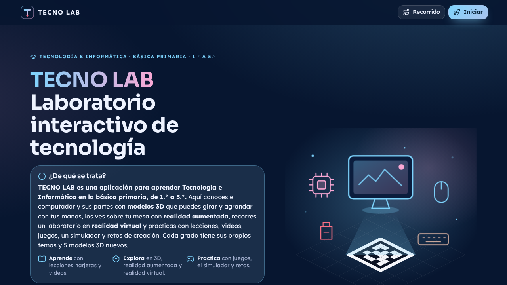
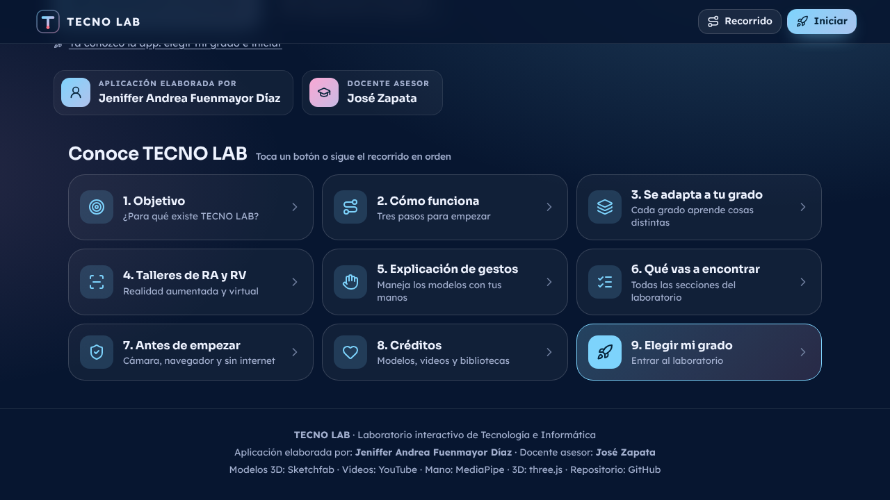
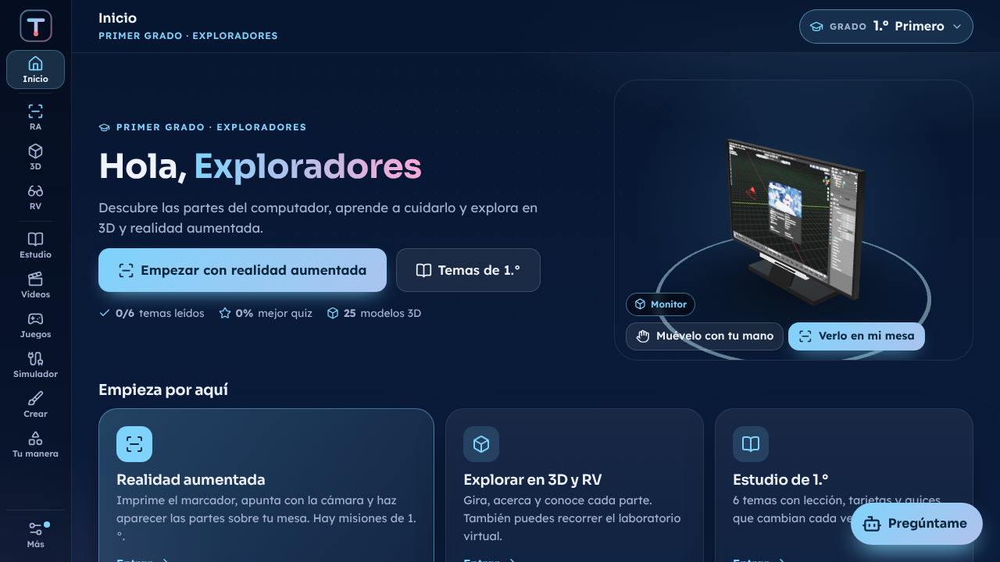
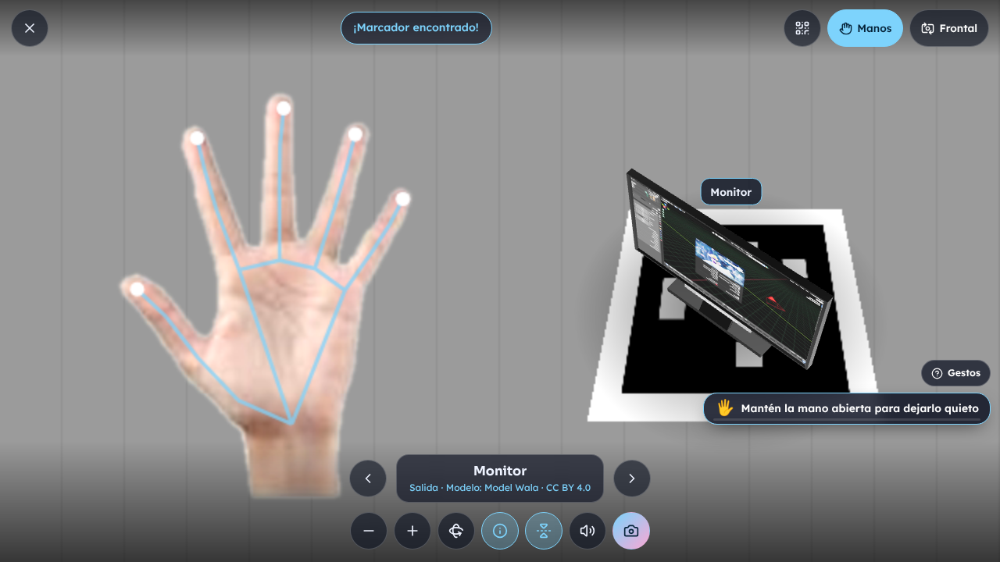
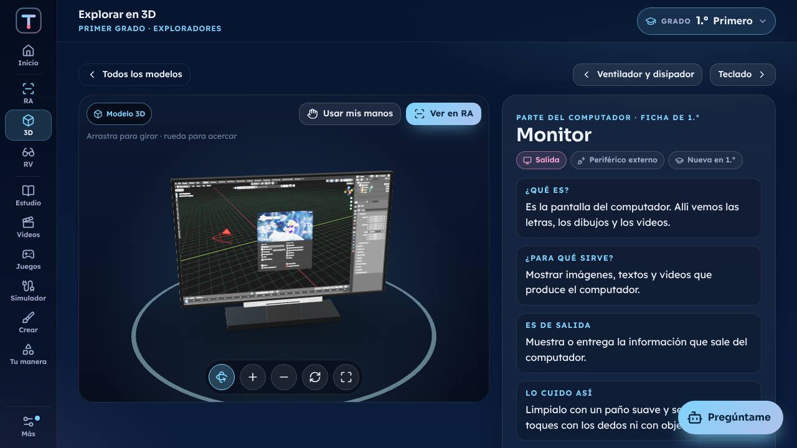
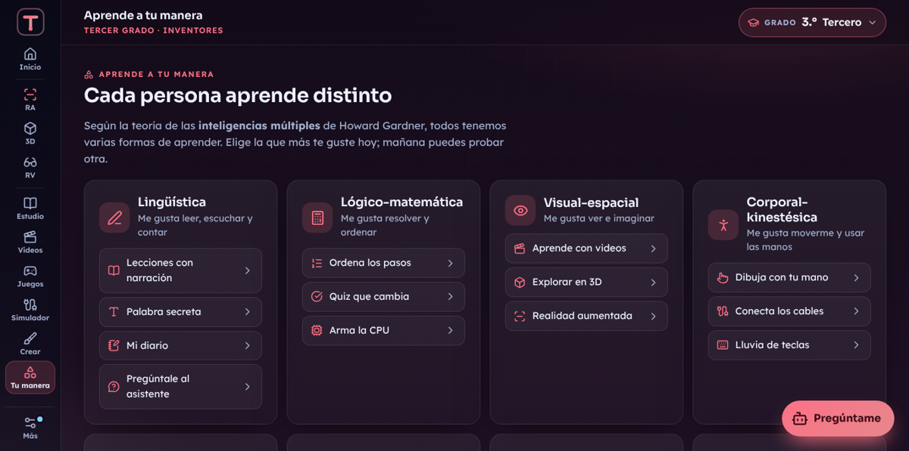

# TECNO LAB · Laboratorio interactivo de Tecnología e Informática

**Aplicación elaborada por:** Jeniffer Andrea Fuenmayor Díaz  
**Docente asesor:** José Zapata  
**Área:** Tecnología e Informática · Básica primaria (1.° a 5.°)





## ¿Qué es TECNO LAB?

TECNO LAB es un laboratorio web para aprender Tecnología e Informática en la básica primaria. Los estudiantes exploran el computador y sus partes con **realidad aumentada**, **realidad virtual** y **modelos 3D reales**, y practican con lecciones, videos, simuladores, juegos y retos. Al abrirse muestra una **portada** que explica de qué se trata la aplicación, con dos caminos:

- **Comencemos el recorrido:** presenta la aplicación paso a paso, empezando por el objetivo (general, específicos y referentes), y sigue con cómo funciona, grados, talleres de RA y RV, gestos, qué vas a encontrar, recomendaciones y créditos. Cada panel tiene una barra con **Atrás**, **Inicio** y **Siguiente**.
- **Iniciar:** va directo a elegir el grado y entrar al laboratorio.

También se puede tocar cualquiera de los 9 botones de la portada para ir a un tema.

### Objetivo general

Fortalecer el aprendizaje del área de Tecnología e Informática en la básica primaria (1.° a 5.°) mediante experiencias interactivas —realidad aumentada, realidad virtual, modelos 3D, gestos con la mano, simulación y juego— que permitan a los estudiantes reconocer los artefactos tecnológicos, comprender el computador y sus partes, y usar la tecnología de forma segura y responsable.

### Objetivos específicos

- Reconocer las partes del computador, su función y su clasificación (entrada, salida, almacenamiento y procesamiento) con modelos 3D y realidad aumentada.
- Relacionar la tecnología con la vida cotidiana según el grado: artefactos, materiales, herramientas, máquinas simples, electricidad y energía.
- Promover el cuidado de los equipos y el uso seguro y responsable de los aparatos y de internet.
- Ofrecer distintas formas de aprender (ver, escuchar, leer, crear, moverse y jugar en equipo) para que cada estudiante avance a su ritmo.

### Referentes del área

- Ley 115 de 1994 (Ley General de Educación), artículo 23: Tecnología e Informática es un área obligatoria y fundamental.
- Ministerio de Educación Nacional (2008). *Ser competente en tecnología: ¡una necesidad para el desarrollo!* Guía 30. Componentes: naturaleza y evolución de la tecnología; apropiación y uso de la tecnología; solución de problemas con tecnología; tecnología y sociedad.
- Ministerio de Educación Nacional (2022). *Orientaciones curriculares para el área de Tecnología e Informática en la educación básica y media.*
- Gardner, H. (1983). *Frames of Mind: The Theory of Multiple Intelligences* (sección “Aprende a tu manera”).

## Se adapta a cada grado

No todos los grados aprenden lo mismo. El botón **Grado** (arriba a la derecha) cambia lecciones, palabras, quices, misiones de realidad aumentada, juegos y colores.

| Grado | Equipo | Algunos temas |
|---|---|---|
| 1.° | Exploradores | ¿Qué es la tecnología?, conozco el computador, encender y apagar bien, uso el mouse, cuido la sala |
| 2.° | Creadores | Dispositivos de entrada y salida, el teclado, dibujo digital, artefactos de ayer y de hoy, materiales |
| 3.° | Inventores | Hardware y software, por dentro de la torre, guardo mis archivos, herramientas manuales, máquinas simples |
| 4.° | Ingenieros | Periféricos, sistema operativo, bits y bytes, internet seguro, el circuito eléctrico, serie y paralelo |
| 5.° | Innovadores | El computador como sistema, historia de los computadores, pensamiento computacional, tipos y fuentes de energía, ciudadanía digital |

## Lo que vas a encontrar

| Sección | Para qué sirve |
|---|---|
| **Realidad aumentada** | Un solo marcador hace aparecer cualquier modelo sobre la mesa. Funciona con la **cámara trasera o la frontal** y se maneja con **gestos de la mano**. El recuadro del marcador aparece **a un lado** de la pantalla (derecha, izquierda o centro, con el botón ⇄) para que el otro lado quede libre para las manos. Misiones por grado: recorrido con narración, ¿qué parte es?, ¿de qué tipo es?, ¿para qué sirve?, ¿dentro o fuera? |
| **Explorar en 3D** | Modelos 3D reales para girar y acercar con botones, con los dedos o con la mano frente a la cámara (**Usar mis manos**), con su ficha de estudio y sus créditos. |
| **Realidad virtual** | Laboratorio 360° con los modelos en pedestales: en pantalla, con visor tipo Cardboard o con visores compatibles. |
| **Estudio** | 35 temas con lección narrada, fichas, tarjetas de repaso y quices que cambian cada vez (también examen imprimible). |
| **Aprende con videos** | Videos de YouTube seleccionados por tema, con sus créditos. La profesora puede agregar más. |
| **Minijuegos** | Clasificador, memoria, palabra secreta y lluvia de teclas, con dificultad por grado. |
| **Simulador** | Conectar los cables, encender en orden y armar la CPU por dentro. |
| **Zona de creación** | Dibujar con la mano frente a la cámara (MediaPipe) y resolver retos como “dibuja un mouse”. |
| **Aprende a tu manera** | Actividades para las inteligencias múltiples: duelo por equipos, ordena los pasos, rimas con ritmo, mi diario y observa y clasifica. |
| **Asistente de preguntas** | Responde dudas de los temas y entiende errores de escritura (“ran” → “¿Quisiste decir memoria RAM?”). Funciona sin internet porque busca en los contenidos del laboratorio. |

**Diseño amable:** nunca se dice “incorrecto”; se usan mensajes como “¡Sigue intentando!” y “¡Puedes mejorar!”. Las respuestas correctas suenan y lanzan confeti. Las opciones de respuesta son blancas, sin colores, para que nadie elija por su color favorito.

| | |
|---|---|
|  |  |
|  |  |

## Gestos

- **Zona de creación (cámara):** dedo índice arriba = dibujar · puño = borrar · mano abierta sobre un botón = elegir (color, siguiente reto, borrar todo, apagar cámara). Los cambios de gesto esperan medio segundo para evitar trazos sin querer.
- **En la RA, el marcador va a un lado:** pon el marcador dentro del recuadro (a la derecha, por defecto) y mueve las manos en el otro lado, donde aparece *Espacio para tus manos*. Así la cámara ve bien las dos cosas.
- **RA y visor 3D con la mano (MediaPipe):** 🙌 dos manos: separarlas amplía el modelo y juntarlas lo hace pequeño · ☝️ dedo índice: aparece un círculo en la pantalla; déjalo quieto sobre un botón y se toca solo · 🖐️ mano abierta: deja el modelo quieto · ✊ puño: agarra el modelo y muévelo para girarlo · ✌️ V: siguiente modelo. Se activa con **Usar mis manos** (visor 3D) o **Manos** (RA) y pide permiso para la cámara.
- **RA y 3D en la pantalla:** un dedo gira el modelo; dos dedos lo acercan o alejan; también hay botones + y −.
- **RV:** arrastrar para mirar; con visor, mirar fijamente una parte unos segundos la selecciona.

---

## Publicar en GitHub Pages

> **No subas el archivo .zip.** GitHub lo guarda como un solo archivo, no lo abre, y desde el navegador no acepta archivos de más de 25 MB. Primero descomprímelo y sube lo que hay adentro. La guía completa, paso a paso, está en `COMO-SUBIR-A-GITHUB.txt`.

1. Descomprime `TECNO-LAB.zip`. Se crea la carpeta `tecnolab` (menos de 100 archivos; el más grande pesa unos 6 MB).
2. Crea un repositorio en GitHub. En *Add file → Upload files* arrastra **todo lo que hay dentro** de la carpeta `tecnolab` (no la carpeta misma: `index.html` debe quedar en la raíz) y toca *Commit changes*. Si GitHub no lo acepta de una vez, súbelo en dos partes: primero todo menos `lib`, y después la carpeta `lib`.
3. En *Settings → Pages* elige *Deploy from a branch*, rama `main`, carpeta `/ (root)`.
4. Abre la dirección que entrega GitHub (`https://usuario.github.io/repositorio/`).

Otra forma, sin los límites del navegador, es **GitHub Desktop**: clonas el repositorio, copias los archivos en esa carpeta y haces *Commit* y *Push*.

La cámara (RA, gestos con la mano y zona de creación) solo funciona en páginas **https** o en `localhost`; GitHub Pages ya usa https.

### Detector de manos en GitHub Pages

TECNO LAB busca primero el detector en `lib/mediapipe/`. Si falta algún archivo (por ejemplo, porque no se subió completo), lo descarga solo de internet (jsDelivr), así los gestos funcionan igual. Para que también funcione sin internet, sube la carpeta `lib/mediapipe` completa (10 archivos).

### Si la cámara no abre en el celular

- Toca **Permitir** cuando el navegador pregunte. Si antes se negó: candado o ícono junto a la dirección → *Permisos* → *Cámara* → *Permitir*, y luego **Reintentar** en la app.
- Si abriste el enlace desde WhatsApp, Instagram o Facebook, ábrelo en Chrome (menú ⋮ → *Abrir en Chrome*).
- En el celular es mejor usar GitHub Pages o la app de Android: al abrir `index.html` desde el administrador de archivos, algunos navegadores no permiten la cámara.
- En la app de Android: *Ajustes → Aplicaciones → TECNO LAB → Permisos → Cámara*. La app pregunta por la cámara al abrirse y tiene un botón **Abrir ajustes**.

## Usar sin internet

- **En el aula:** abre la página una vez con conexión y, en **Más opciones** (engranaje del menú), pulsa **Preparar para usar sin internet**.
- **Instalar como app:** en Chrome o Edge usa “Instalar app”; en iPhone o iPad, Safari → Compartir → “Agregar a pantalla de inicio”.
- **Con doble clic en `index.html`:** funciona sin servidor y sin internet si está **junto a sus carpetas** (`models`, `lib`, `assets`), es decir, con el zip descomprimido completo. El `index.html` trae dentro el motor 3D (three.js), el detector del marcador (ArUco) y las fuentes, y carga los 25 modelos desde `models/js`. Solo los gestos con la mano y los videos necesitan internet al abrirlo así.
- **Un solo archivo:** `python3 src/construir.py --un-archivo` crea `TECNO-LAB-un-archivo.html`, que trae todo adentro (incluidos los modelos) y funciona solo, por ejemplo para enviarlo por correo o copiarlo en una memoria USB.
- Los videos siempre necesitan conexión porque se reproducen desde YouTube.

## Apps para instalar

| Sistema | Archivo | Cómo se instala |
|---|---|---|
| Android | `TECNO-LAB-Android.apk` | Abrir el archivo en el celular o tableta y permitir “instalar apps de origen desconocido”. |
| Windows | `TECNO-LAB-Windows.zip` | Descomprimir y abrir `TECNO LAB.exe`. Si aparece “Windows protegió su PC”: *Más información → Ejecutar de todas formas*. |
| macOS | `TECNO-LAB-Mac-AppleSilicon.zip` (M1 a M4) o `TECNO-LAB-Mac-Intel.zip` | Arrastrar `TECNO LAB.app` a Aplicaciones y abrirla la primera vez con clic derecho → *Abrir*. |
| iPhone / iPad | — | Abrir la página en Safari → Compartir → *Agregar a pantalla de inicio*. |

Las apps incluyen todo el laboratorio y funcionan sin internet (los videos sí necesitan conexión). Como pesan más de 25 MB, no van dentro del repositorio: se publican en la sección **Releases**, que acepta archivos de hasta 2 GB. El código de las apps está en `apps/`.

## Modelos 3D

TECNO LAB trae **25 modelos 3D reales: 5 nuevos en cada grado**. Cada grado ve sus 5 modelos nuevos y repasa los de los grados anteriores (1.° = 5, 2.° = 10, 3.° = 15, 4.° = 20, 5.° = 25).

| Grado | Modelos nuevos |
|---|---|
| 1.° | Monitor, teclado, mouse, unidad central (torre), parlantes |
| 2.° | Impresora, audífonos, micrófono, cámara web, parlante Logitech |
| 3.° | Memoria USB, pantalla táctil, control de videojuegos, proyector, impresora multifuncional |
| 4.° | Regulador de voltaje, tarjeta madre, memoria RAM, disco duro, fuente de poder |
| 5.° | Ventilador y disipador, unidad SSD, tarjeta de video, router, UPS |

Se describen en `models/modelos.json` (archivo, parte, grado, autor, licencia y enlace). Todos vienen de **Sketchfab** con licencias Creative Commons y se optimizaron para la web sin cambiar su forma. Cada modelo está en `models/js/<nombre>.js` (el archivo .glb guardado dentro de un .js): así carga en GitHub Pages, en las apps y también al abrir `index.html` con doble clic, y ningún archivo pasa de 2 MB. Para recuperar los .glb originales: `python3 src/construir.py --extraer-glb`.

- **En GitHub, sin programas:** sube el `.glb` a la carpeta `models/` y agrégalo a `modelos.json`; en GitHub Pages aparece enseguida. Para que también funcione con doble clic y sin internet, ejecuta `python3 src/construir.py` (crea su archivo en `models/js/`).
- **Parte de la lista base:** usa su nombre (`escaner.glb`, `procesador.glb`…) y agrégalo a `modelos.json` con `"parte"`.
- **Otra versión de una parte:** usa `"variante_de": "mouse"`.
- **Objeto nuevo** (un carro, un robot…): pon `"nombre"`, `"tipo"`, `"grado"` y `"descripcion"`; aparecerá en 3D, RA y RV.
- **Desde la app:** el botón **Subir modelo** guarda el .glb en ese navegador (también se ve en 3D, RA y RV). “Descargar para GitHub” entrega el archivo con el nombre correcto.

El escáner y el procesador todavía no tienen modelo 3D: aparecen en el estudio con su ficha e icono, pero no en la galería 3D.

## Marcador de realidad aumentada

Está en `assets/marcador/` (PDF, PNG y SVG) y también se descarga desde la app. Imprímelo en tamaño carta al 100 %: el cuadro negro mide 15 cm. Es un marcador ArUco (diccionario ARUCO_MIP_36h12, id 42).

## Estructura de la aplicación

```
├── index.html            Aplicación (carga los modelos de models/js)
├── COMO-SUBIR-A-GITHUB.txt  Guía para subir el proyecto y publicarlo
├── sw.js                 Funcionamiento sin internet
├── manifest.webmanifest  Instalación como app
├── models/               modelos.json (créditos, grado y miniatura) y LEEME.txt
│   └── js/               Los 25 modelos 3D, uno por archivo
├── assets/               Iconos y marcador de RA
├── lib/                  three.js, js-aruco2, MediaPipe Hands, Draco y fuentes
├── LICENCIAS/            Licencias y créditos de terceros
├── docs/capturas/        Imágenes de este documento
├── apps/                 Código de las apps de Android y de escritorio
└── src/                  Código fuente por módulos
    ├── shell.html        Estructura
    ├── styles.css        Estilos y temas por grado
    ├── js/               Módulos (datos, 3D, RA, RV, estudio, juegos, videos…)
    └── construir.py      Une los módulos en index.html y crea models/js
```

Para modificar el código o cambiar modelos: edita los archivos de `src/` o de `models/` y ejecuta `python3 src/construir.py` (Python 3, sin instalar nada más); se generan de nuevo `index.html` y `models/js/`.

## Privacidad

La cámara se procesa en el mismo dispositivo; no se envían imágenes ni datos a ningún servidor. El progreso, los dibujos, el diario y los modelos subidos se guardan solo en el navegador.

## Créditos

- **Modelos 3D:** [Sketchfab](https://sketchfab.com). Autores y licencias en `models/modelos.json`, `LICENCIAS/CREDITOS-MODELOS-3D.txt` y en la sección *Créditos* de la app.
- **Videos:** [YouTube](https://www.youtube.com). Cada video muestra su título y su canal; pertenecen a sus autores.
- **Reconocimiento de manos:** [MediaPipe Hands](https://github.com/google-ai-edge/mediapipe) (Google) · Apache 2.0. Gestos en la RA, el visor 3D y la zona de creación.
- **Motor 3D, RA y RV:** [three.js](https://threejs.org) · MIT.
- **Detección del marcador:** [js-aruco2](https://github.com/damianofalcioni/js-aruco2) · MIT.
- **Compresión de modelos:** Draco (Google) · Apache 2.0; meshoptimizer · MIT; optimizados con glTF-Transform · MIT.
- **Iconos:** [Lucide](https://lucide.dev) · ISC. **Fuentes:** Sora y Lexend · SIL OFL 1.1.
- **Repositorio y publicación:** [GitHub](https://github.com) y GitHub Pages.

---

**TECNO LAB** · Aplicación elaborada por: Jeniffer Andrea Fuenmayor Díaz · Docente asesor: José Zapata
